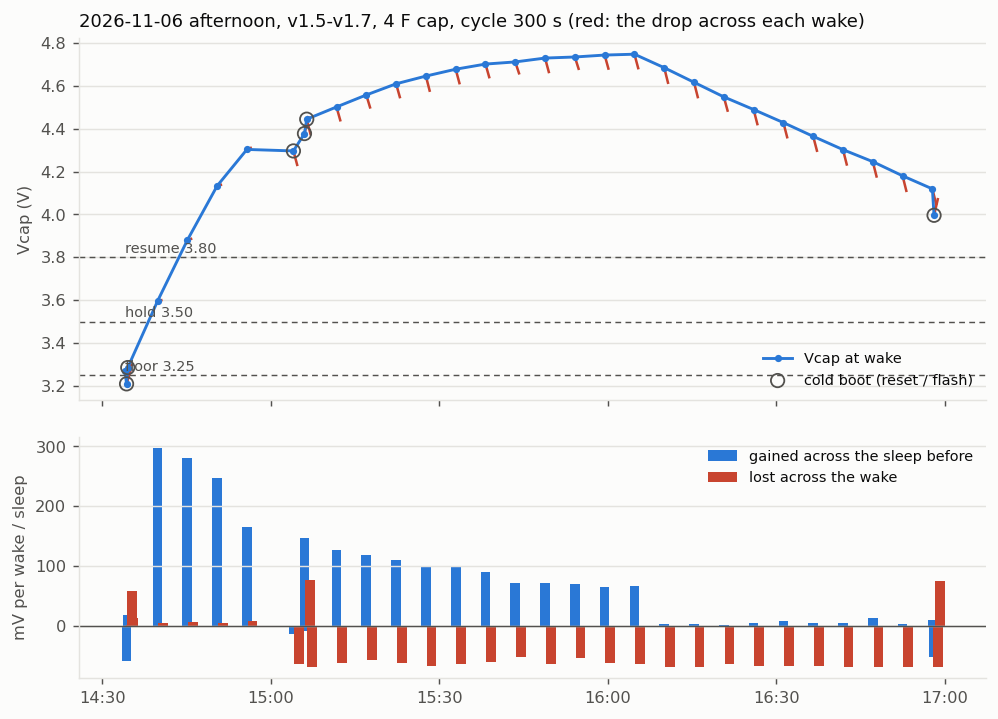

# Afternoon on the cap, read out 2026-11-06 16:59

Firmware v1.5 → v1.6 (15:05, +400 ms e-paper refresh margin) → v1.7 (16:58,
signed trend in the header). Soldered XIAO on VCAP, 4 F pack, panels, indoors.
Settings changed over the console this afternoon: `cycle_s` 15 → 300 (14:28),
`poll_s` 15 → 300 (14:34). Log dumped with `tools/dump_log.py`.

* `flashlog_165914.csv` - the dump, 1207 records, unchanged
* `console_165914.txt` - everything the board printed while dumping
* `afternoon.png` - `python data/2026-11-06/plot_afternoon.py`, records 1176-1207

The log has no clock, and this stretch has six cold boots, so `plot_log.py`
(one unbroken run) cannot place it. Times come from anchors seen live on the
console (14:28:47, 14:34:01, 14:34:17, 15:05:58, 15:06:22, 16:57:47), with timer
wakes spread evenly between them. 21 cycles took 15:06:22 → 16:57:47, so a
300 s sleep is **~318 s wake to wake**. Times are good to about ±2 min.

## What happened

| Time | Records | Vcap | What |
| ---- | ------- | ---- | ---- |
| before ~14:15 | …-1139 | 5.09 V | On USB, 15 s bench cycles |
| ~14:15-14:34 | 1140-1177 | 3.27 V | On the cap, below `v_hold`: 15 s held polls, no refresh. Cold boots are console sessions |
| 14:34-14:56 | 1178-1182 | 3.29 → 4.31 V | +300 → +165 mV per sleep (+4.0 → +2.2 mA). Wakes cost nothing (`dv_cycle` +4..+8 mV), so the board was not running from the cap |
| 15:04-15:06 | 1183-1185 | 4.30 → 4.44 V | v1.6 flash and a RESET |
| 15:11-16:05 | 1186-1196 | 4.44 → 4.75 V | Board on the cap. Each sleep gains +126 → +64 mV (+1.7 → +0.9 mA net), each wake costs ~62 mV. Cap climbing |
| 16:10-16:58 | 1197-1206 | 4.68 → 4.05 V | Gain drops in one step to +2..+13 mV per sleep. Each wake still costs ~68 mV, so Vcap falls ~63 mV per cycle |
| 16:58 | 1207 | 4.00 V | v1.7 flash |

No `incomplete` records anywhere in the log. The cap never browned out mid-update
today, so the white screens are not a brownout. That fits the e-paper
timing (fixed 4.1 s wait, ~90 ms margin), which v1.6 addresses.

Open question: the step at ~16:05 (+67 → +2 mV per sleep within one cycle) is
too sharp for daylight fading on its own. Sunset is ~17:05. A lamp, the sun
going behind something, or a USB / jumper change would each explain it. The
14:34-14:56 stretch is also unexplained: strong charging, and the board not drawing from
the cap. That matches USB on with the VCAP jumper open, so only the panels charge
the cap. Write down the setup next time.

## Power use

**A wake costs ~65 mV of the cap** (`dv_cycle`, 1186-1206: -53 to -70, mean
-65). This is read twice inside the same wake, so it is the most direct number in
the log. At the nominal 4 F that is **~0.26 C per wake**, against ~0.19 C
measured on the bench on 2026-10-30. The gap is about the cap's own tolerance:
4 F nominal could easily be ~3 F. The old in-code estimate (~70 mV per full
cycle) still holds.

**Sleep could not be separated today.** Even at dusk the sleeps gained a few mV,
so the panels still covered the ~0.19 mA bench sleep current (~14 mV per
318 s at 4 F).

**Budget at `cycle_s` 300:**

| | per 318 s cycle | share |
| - | - | - |
| wake (refresh, sensor, boot) | ~65 mV | ~80 % |
| sleep, 0.19 mA (bench) | ~14 mV | ~20 % |
| **total** | **~80 mV ≈ 1.0 mA average** | |

* **Break-even harvest is ~1 mA.** From 15:11 to 16:05 the panels gave more and
  the cap climbed to 4.75 V. After 16:05 they gave almost nothing and the node
  lost ~0.7 V per hour.
* **Tonight, if dark:** 4.0 V at 16:58 reaches `v_hold` 3.50 V around 17:40.
  Held, it costs sleep plus polls, ~0.2 V per hour, so it reaches the ~2.8 V lock-up
  point around 21:00-22:00. A November night is ~14 h, so the node goes flat
  every night whatever the refresh interval. Recovering the next morning needs
  the MCP111 supervisor (`gpio_xiao.md`).
* **The refresh interval is the lever by day:** the wake is ~80 % of the spend.
  `cycle_s` 600 cuts the average to ~0.6 mA, 900 to ~0.45 mA. **The sleep
  current is the lever by night.**
